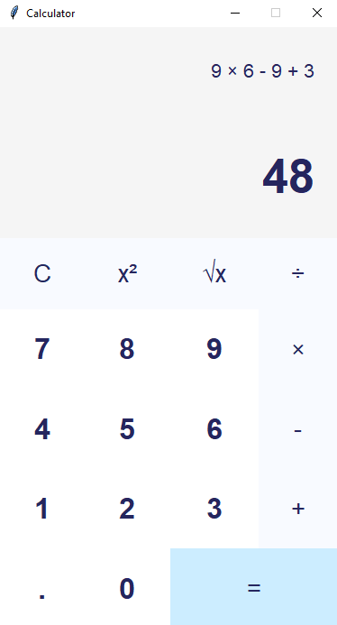

# Calculator
Create your own Python Calculator App using Python and tkinter.

Video Link: [https://youtu.be/QZPv1y2znZo](https://youtu.be/QZPv1y2znZo)



---

## Create Standalone Executable

```shell
pip install pyinstaller
pyinstaller --onefile -w calc.py
```

## How to Run

1. Clone the repository.
2. Open the project directory.
3. Run the Python program using:

```bash
python main.py

## Example Output

```text
Enter your name: Vaishu
Hello, Vaishu!